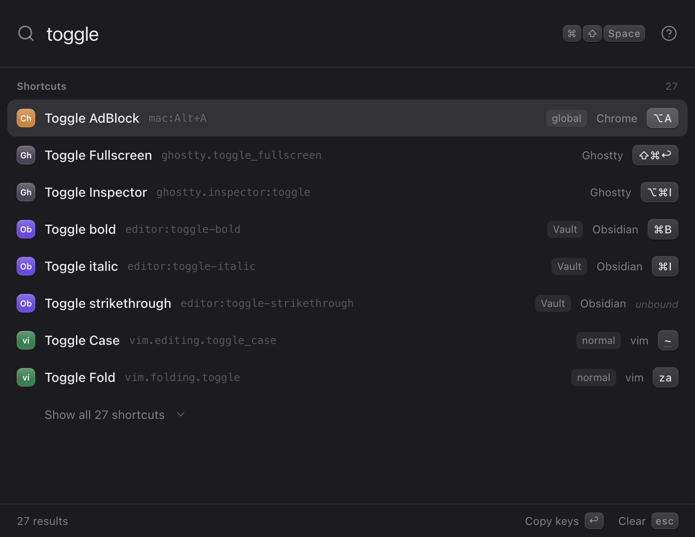

<div align="center">

# Shortty

**Every keybinding of your apps in one Spotlight-style launcher.**

[](https://github.com/giocaizzi/shortty/actions/workflows/ci.yml)
[](LICENSE)

</div>

---

Shortty is a macOS menu-bar app that reads the keyboard shortcuts configured in your tools and the CLI commands on your PATH, and lets you search them from a floating launcher opened with `Cmd+Shift+Space`. Type, arrow to the hit, press Enter to copy it. Everything stays on your machine.



## Features

- **Shortcuts from your tools**: VS Code, Ghostty, tmux, Zsh, Bash, Vim, Obsidian, Chrome and macOS system shortcuts, plus a Finder cheatsheet. Built-in defaults are merged with your own config files, so remapped and unbound keys show as you set them.
- **CLI commands**: every executable on your PATH with its one-line description; drill into a command to browse its subcommands, flags and arguments, read from man pages and `--help`.
- **Keyboard-layout aware**: keys are shown, searched and copied as labelled on your keyboard (Italian, German, Dvorak, ...), not as a US layout.
- **Live reload**: config files are watched, so an edit (or a newly created config) shows up without restarting Shortty.
- **One fuzzy search** across sources, shortcuts and commands, with an optional `>` prefix to search commands only.
- Light and dark appearance, a Preferences window in the style of System Settings, and a menu-bar icon you can hide.

## Quickstart

```sh
make install   # npm ci
make dev       # start the app with hot reload
make check     # lint + test
make e2e       # build, then run the end-to-end suite on the real app (macOS)
make make      # build the DMG and ZIP into out/make
```

`make help` lists every target.

## Documentation

See [docs/](docs/README.md): the product spec, screens, keyboard layouts, runbooks (e2e tests, macOS release, resetting settings) and the v1 status.

## License

[MIT](LICENSE)
