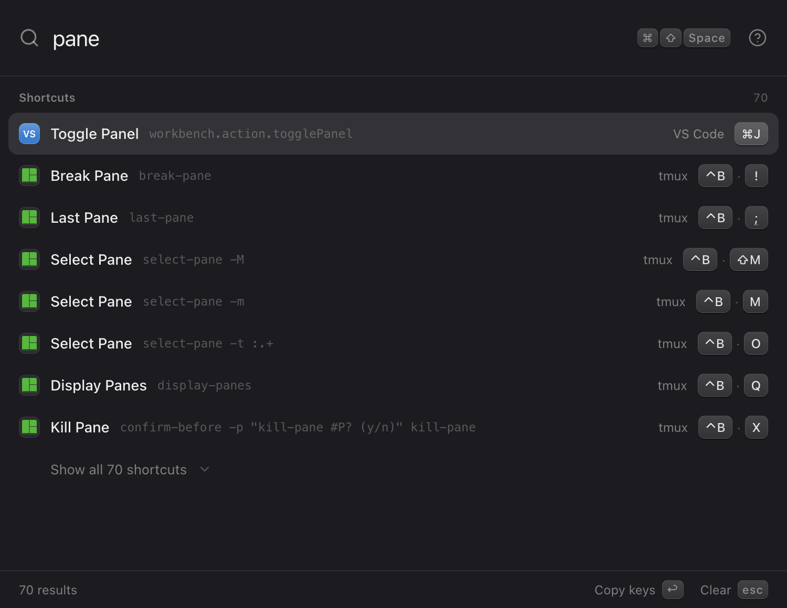
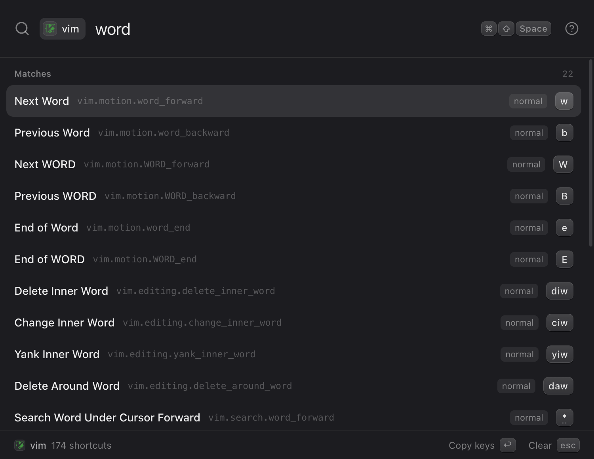
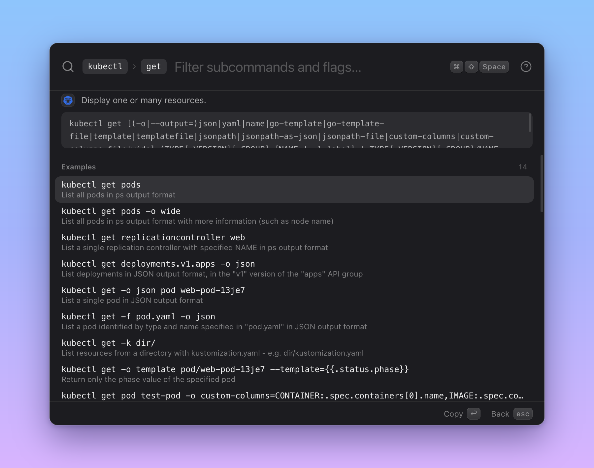

<div align="center">

# Shortty

**Every shortcut and every CLI flag, one keystroke away.**

`⌘⇧Space` (Windows: `Ctrl+Shift+Space`) → type → `↩` copied.

[](https://github.com/giocaizzi/shortty/releases/latest)
[](https://github.com/giocaizzi/shortty/releases)
[](https://github.com/giocaizzi/shortty/actions/workflows/ci.yml)
[](LICENSE)

[-black?style=for-the-badge&logo=apple)](https://github.com/giocaizzi/shortty/releases/latest/download/Shortty-macOS-arm64.dmg)
[-0078D4?style=for-the-badge&logo=windows)](https://github.com/giocaizzi/shortty/releases/latest/download/Shortty-Windows-x64-Setup.exe)
[-E95420?style=for-the-badge&logo=linux&logoColor=white)](https://github.com/giocaizzi/shortty/releases/latest/download/Shortty-Linux-x64.deb)



</div>

Forgot the tmux binding to break out a pane? The vim motion for the end of a WORD? The `kubectl get` flag for custom columns? Shortty is a menu-bar / system-tray launcher for macOS, Windows and Linux that reads the keyboard shortcuts of your tools (your own config included) and the help of every CLI on your PATH, and puts them all behind one fuzzy search. Nothing leaves your machine.

## Your keybindings, as you configured them

Shortty ships curated defaults for **tmux, vim, VS Code, Ghostty, Zsh, Bash, Obsidian, Chrome, Finder and macOS**, and on Windows **Windows, File Explorer, Windows Terminal, PowerShell and PowerToys**, then merges in your config files: a remap in `~/.config/vim/vimrc` or `.tmux.conf` shows up as you set it, live, without a restart. Drill into one source to browse it on its own.

<div align="center">

</div>

## Every CLI on your PATH, down to the last flag

Type `>` and a command: Shortty reads its man page and `--help` in the background and lets you walk subcommands, flags, arguments and examples, at any depth. `>kubectl get ` drills straight in; Enter copies the whole command line, ready to paste.

<div align="center">

</div>

Parsed help formats include cobra (kubectl, gh, docker, helm), clap, click, argparse, gcloud, az, aws and classic man pages.

## Also

- **Keyboard-layout aware**: keys are shown, searched and copied as labelled on *your* keyboard (Italian, German, Dvorak…), not a US layout.
- **Resume where you left off**, or start blank: your call in Settings (`⌘,`).
- **Sandboxed probing**: help is read with a stripped environment, a timeout and a blocklist; OS binaries are never run.
- Light and dark, a System Settings-style Preferences window, a menu-bar icon you can hide.

## Install

Grab the latest release with the buttons above, or from [Releases](https://github.com/giocaizzi/shortty/releases):

- **macOS**: open `Shortty-macOS-arm64.dmg` (Apple silicon) or `Shortty-macOS-x64.dmg` (Intel, from [Releases](https://github.com/giocaizzi/shortty/releases)) and drag Shortty to Applications.
- **Windows** (x64): run `Shortty-Windows-x64-Setup.exe` (installs for your user, no admin). SmartScreen may warn about an unknown publisher: More info → Run anyway. Windows releases are not signed yet; see the [code signing policy](https://github.com/giocaizzi/shortty/blob/main/docs/code-signing-policy.md) (signing through SignPath Foundation is pending) and the [privacy policy](https://github.com/giocaizzi/shortty/blob/main/docs/privacy-policy.md).
- **Linux** (x64): `sudo apt install ./Shortty-Linux-x64.deb` or `sudo dnf install ./Shortty-Linux-x64.rpm`.

Or build it yourself: `make install && make make` (installers land in `out/make`).

## Develop

```sh
make dev       # run with hot reload (quit an installed Shortty first)
make check     # lint + test
make e2e       # end-to-end suite on the real app (macOS)
```

`make help` lists every target. Docs, spec and runbooks live in [docs/](docs/README.md).

## License

[MIT](LICENSE)
