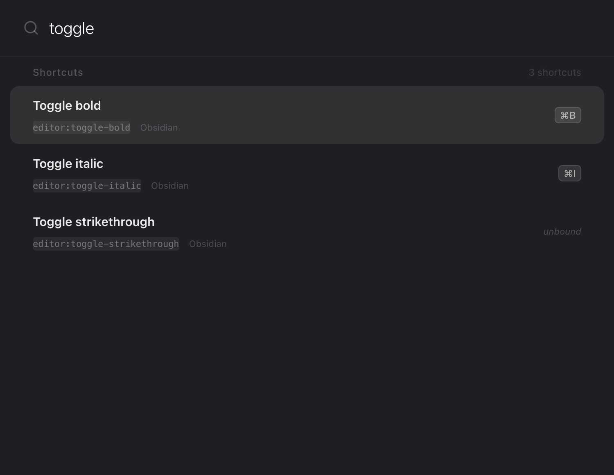
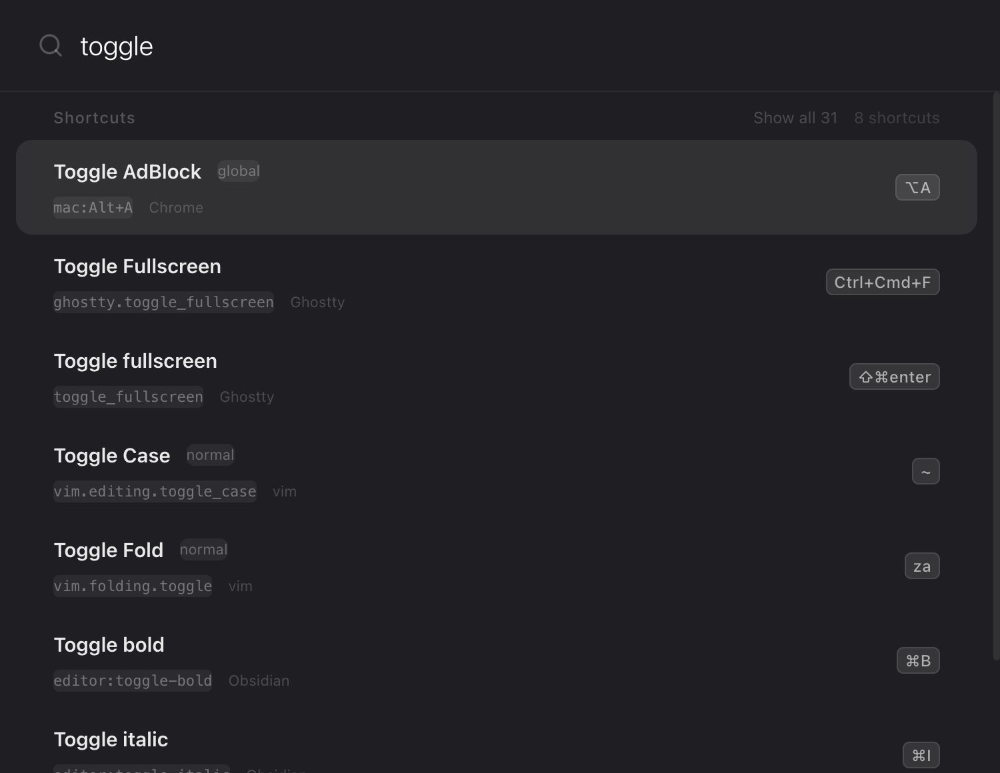
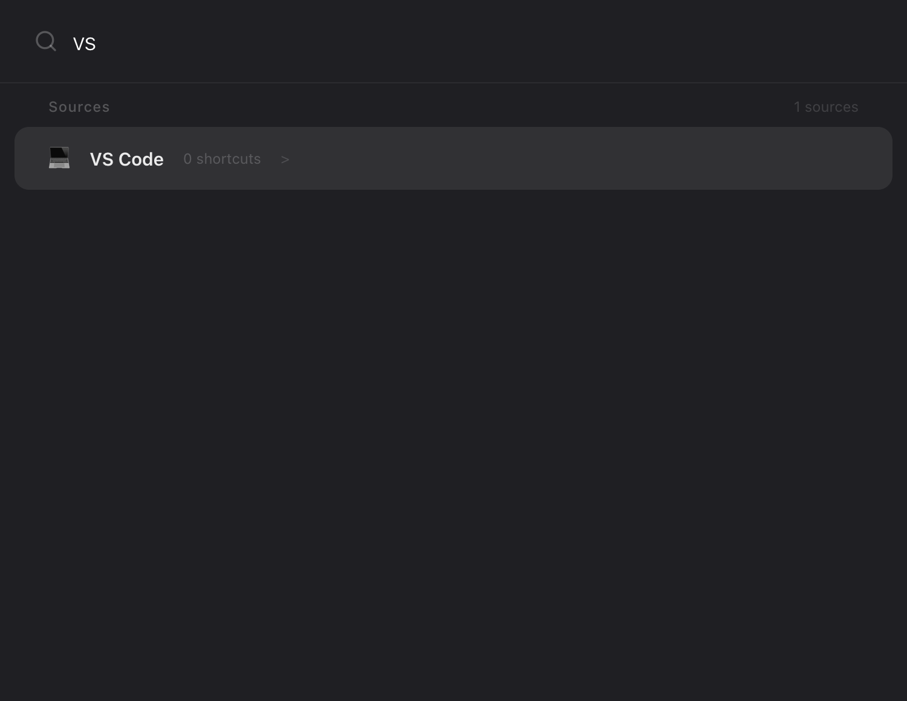
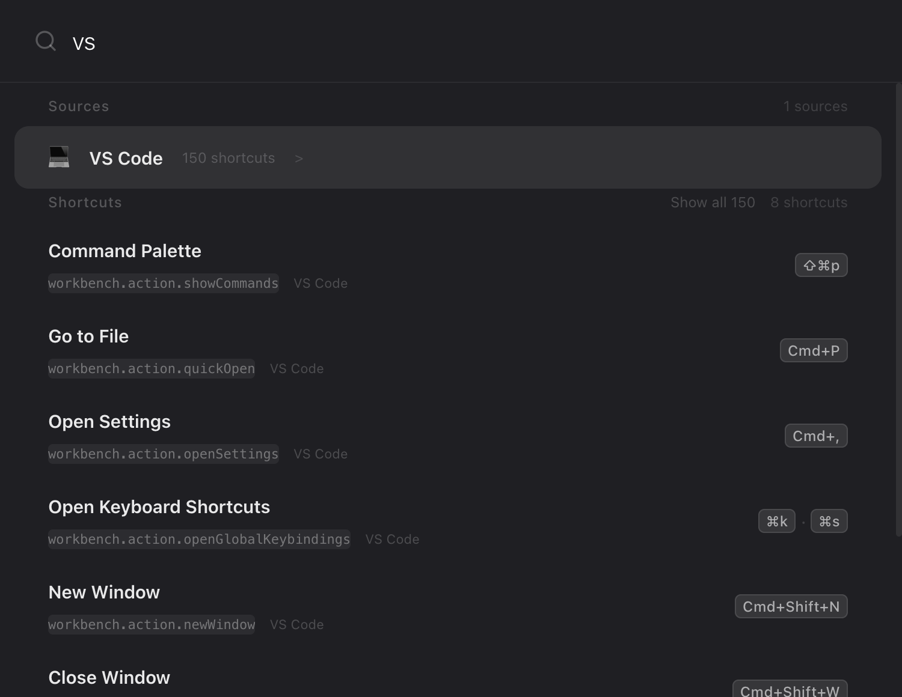
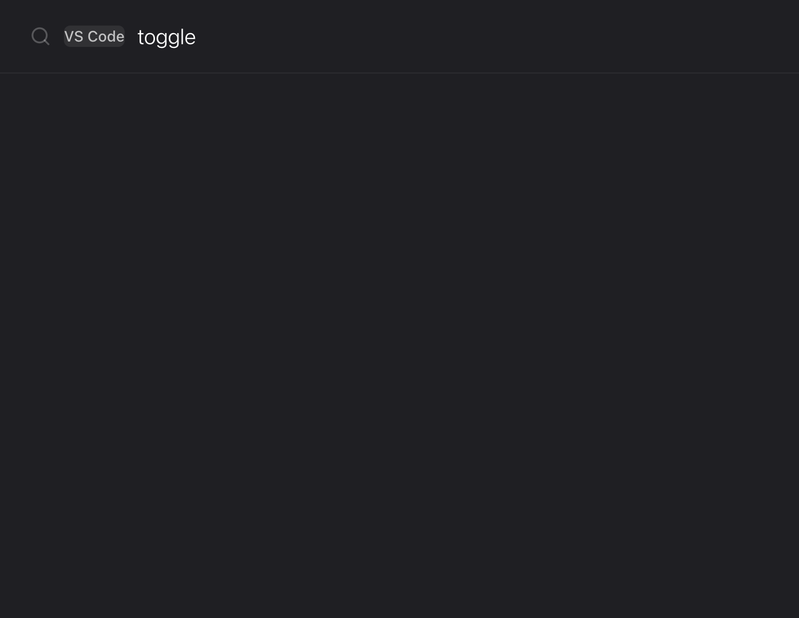
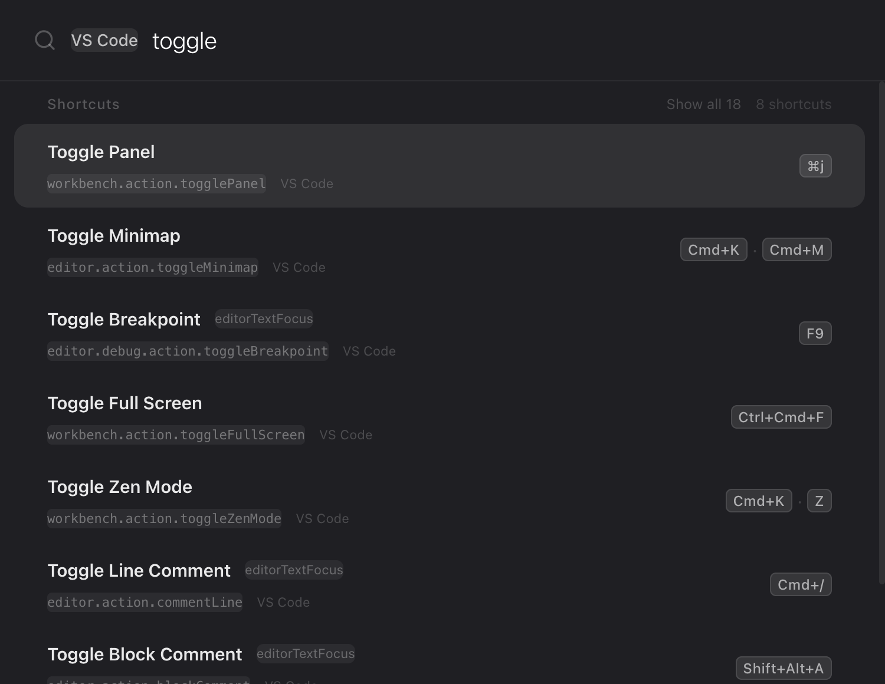
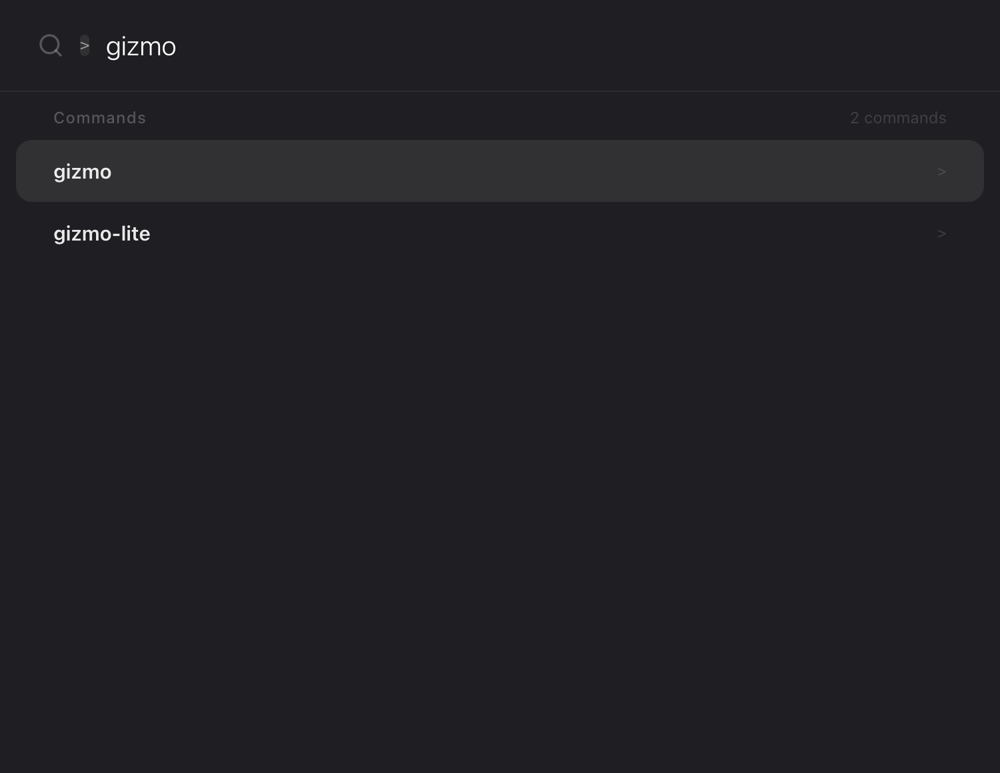
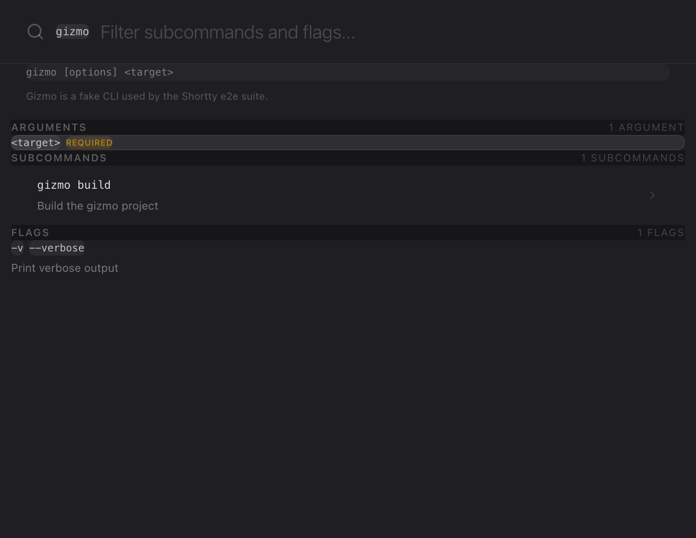
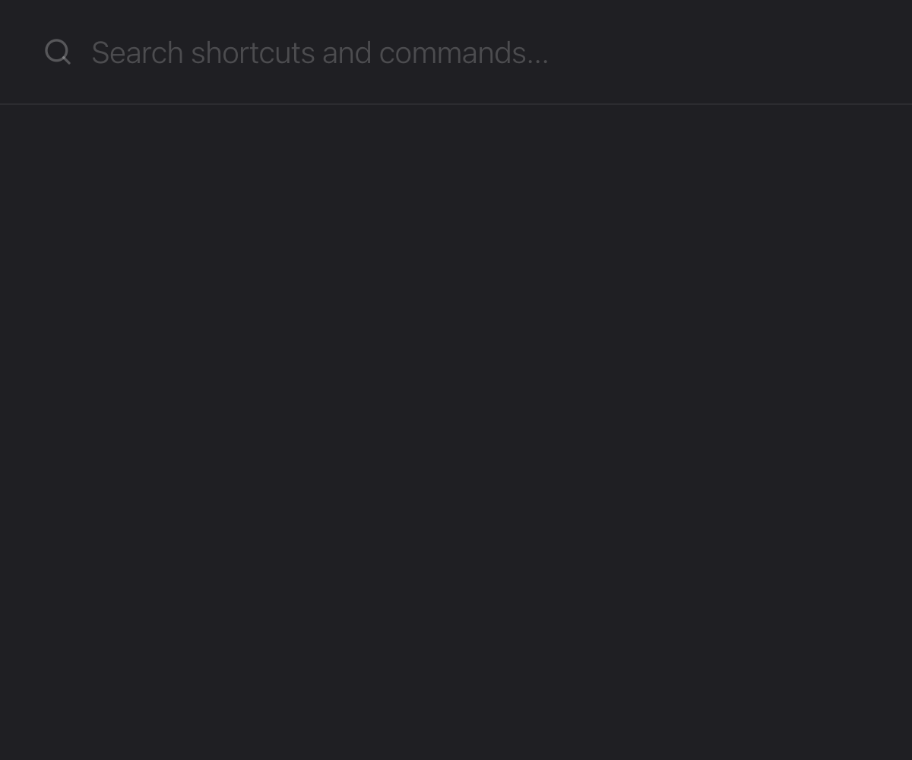

# Baseline benchmark (2026-10-14)

How the app behaves today, measured by the e2e harness (`docs/e2e.md`) on
`feat/finish-v1` (base `2c04f49`), macOS arm64, Electron 44.7.0. Hermetic run:
fixture configs in a fake `HOME`, three fake executables on `PATH`.

Reproduce: `make e2e` (behaviour) and `make e2e-benchmark LABEL=baseline`
(timings + screenshots). Raw numbers: `benchmark/baseline-timings.json`,
`benchmark/workaround-timings.json`.

Two runs:

- **baseline**: the build as it is.
- **workaround**: same build plus an untracked `cheatsheets -> src/cheatsheets`
  symlink at the repo root, to show the app once bug 2 below is fixed. Not
  committed.

## Before anything ran: the build was broken

Since the Electron Forge 8 bump (`c90dd0c`), the Vite plugin emits
`.vite/build/index.cjs` and `preload.cjs`, but `package.json` `main` pointed at
`index.js` and both windows loaded `preload.js`. `make package` failed and, when
started directly, the renderer had no `window.electronAPI` and showed
"Something went wrong". Fixed in this change (`package.json` `main`,
`src/main/index.ts`, `src/main/preferences-window.ts`) because no test could run
otherwise. `make dev` starts the same entry point, so it was most likely affected
too (not verified).

## Numbers

| Metric | baseline | workaround |
|---|---|---|
| Data loaded | 9 sources, 5 shortcuts, 3 commands | 10 sources, 493 shortcuts, 3 commands |
| Launch to ready (median of 3, fresh profile) | 310 ms | 325 ms |
| Launch to commands enriched (3 fake bins) | 696 ms | 714 ms |
| `show()` to search input focused | 39 ms | 34 ms |
| Query set to first row rendered, `vs` (source) | 0.5 ms | 1.7 ms |
| Query set to first row rendered, `toggle` (shortcuts) | 0.9 ms | 3.1 ms |
| Query set to first row rendered, `>gizmo` (commands) | 0.5 ms | 0.4 ms |

"Ready" = the main process finished `app.on('ready')` (parsers, commands
engine, watcher). Search timings are medians of 5 runs, measured in the
renderer from input event to the row in the DOM, so they include Fuse.js and
React. The first launch on a machine is slower (~0.8 s) because of OS caches.
Search is well under the 5 ms target of SPECS §10.3 at fixture scale; it was
not measured against a real PATH (thousands of commands).

## What works (25 passing tests)

- Launches hidden; `show` focuses an empty search bar; `toggle` hides.
- Window is a compact 72 px bar when empty and grows to 580 px with results.
- Full reset (query, drill level) every time the panel is shown.
- Esc clears a non-empty query.
- `>` prefix: badge in the search bar, only the Commands section, Backspace on
  the bare prefix leaves prefix mode.
- Commands engine is hermetic: indexes exactly the PATH dir, enriches from
  `--help`.
- Arrow navigation with wrap-around; Enter copies the command name.
- Tab or → drills into the command detail (synopsis, description, arguments,
  subcommands, flags); typing filters it; Enter copies the subcommand or flag;
  Tab on a subcommand drills one level deeper and Esc goes back with the
  selection restored; Esc from the detail returns to flat mode.
- Enter on a source row drills into it (placeholder "Search in VS Code...");
  Esc returns to flat.
- `?` and `>` follow the produced character (`KeyboardEvent.key`), not the
  physical key: verified for US and Italian positions (`?` = Shift+Minus,
  `>` = Shift+IntlBackslash, and Shift+Slash types `_` without opening help).
- The preferences window opens as a second window.

## What is broken or diverges (18 tests marked fixme)

| # | Area | Finding | Test(s) |
|---|---|---|---|
| 1 | Build | Forge 8 output names (`.cjs`) not reflected in `main`/preload paths. **Fixed here.** | all |
| 2 | Shortcuts | `loader.ts` resolves `../../cheatsheets/sources` from `.vite/build`, i.e. `<root>/cheatsheets/sources`, which does not exist (and is not packaged). No cheatsheet loads, so no parser gets config paths: only Obsidian (vault auto-discovery) yields shortcuts; VS Code shows "0 shortcuts". | 7 tests in `shortcuts.spec.ts` |
| 3 | Dismiss | Esc on an empty query and dismiss-after-copy call `window.blur()` in the renderer, which does not blur or hide the BrowserWindow. The panel stays open. | 2 |
| 4 | Help | Pressing `?` opens the overlay and closes it in the same keystroke: its `window` keydown listener is attached synchronously and receives the same event. The overlay is never visible. | 1 |
| 5 | Help | No `?` icon in the search bar (SCREENS §3); `onHelpToggle` is passed but never rendered. | 1 |
| 6 | Preferences | Both renderers are built from `index.html`, so the preferences window renders the launcher, not the General/Sources/Search/Commands UI (`preferences.html` is unused). | 1 |
| 7 | Commands | `--help` parser keeps only the first entry of each section (`gizmo deploy`, `--quiet` missing): multiline `$` in the section lookahead ends the match after one line. | 1 |
| 8 | Search | With command prefix mode on (default), flat search still returns commands; SPECS §9 says flat = shortcuts only. | 1 |
| 9 | Drill-in | A drilled source shows nothing until you type (empty query returns no results); SCREENS §2.1 lists all entries. | 1 |
| 10 | Drill-in | Esc from a drilled source or a command detail clears the query instead of restoring the previous one (SCREENS §2.1, SPECS §10.7). | 2 |
| 11 | Window | 750 px wide with dynamic 72/580 px height, not the fixed 680x500 of SPECS §10.8. | 1 |

Seen in screenshots, not asserted:

- Key labels mix glyph and text styles in the same list: `⌘j`, `⇧⌘enter` vs
  `Cmd+K`, `Ctrl+Cmd+F`, `Shift+Alt+A` (cheatsheet keys are not normalized).
- Duplicate entries when a user config and the cheatsheet name the same action
  differently (`Toggle Fullscreen` / `Toggle fullscreen` for Ghostty).
- Drilled rows still show the source label (SCREENS §8.2 hides it).
- Section counts are not pluralized ("1 sources", "1 SUBCOMMANDS") and the
  section header shows both "Show all 31" and "8 shortcuts".
- Command detail: argument and flag rows lack the row padding used elsewhere;
  no header with the command name (SCREENS §2.3).
- `--help` enrichment leaves `shortty-help-*` dirs behind in `TMPDIR`.

## Screenshots

The real panel is transparent with OS-composited vibrancy, which a page
screenshot cannot capture; the benchmark paints a dark backdrop
(`#1f1f23`) for readability. Window width 750 px, shown at 2x.

| State | baseline | workaround |
|---|---|---|
| Empty panel |  |  |
| Search `toggle` |  |  |
| Search `vs` (source) |  |  |
| Drilled into VS Code, `toggle` |  |  |
| `>gizmo` prefix mode |  |  |
| `gizmo` command detail |  |  |
| Preferences window (renders the launcher, bug 6) |  |  |
